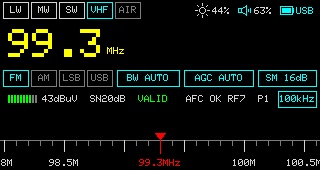
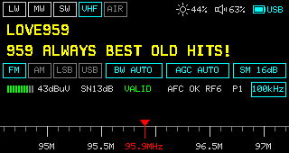

# tinyradio

**AM/FM/SSB receiver firmware for SI4732 radios.**

Tune LW, MW, SW, and VHF/FM with one encoder. Adjust reception, search for stations, and resume your saved settings when you switch the radio back on.

<table>
  <tr>
    <td></td>
    <td></td>
  </tr>
</table>

*Actual receiver screenshots: frequency view and RDS view.*

## Features

- Continuous tuning across LW, MW, SW (1.711–30 MHz) and VHF/FM, with selectable modes and steps, and a per-band lock.
- Seek by rotating the encoder; short-press to return to manual tuning.
- Adjustable bandwidth, gain, soft mute, volume, and brightness; dark and light themes.
- RDS station names, scrolling radio text, and broadcast clock, including UTF-8 eRT support.
- Battery percentage or voltage, saved tuning and reception settings, and full-screen screenshot export.
- On the GeekNest V5A: AIR 118–137 MHz, side keys, audio spectrum, temperature/humidity, RTC, and software power off.

## Supported hardware

| Board | MCU | Build | Status |
| --- | --- | --- | --- |
| Sunnygold SI4732 Mini (ATS Mini) | ESP32-S3 | `ats-mini` | Supported; release builds and the [hardware facts](docs/hardware-ats.md) cover this board |
| GeekNest V5A | ESP32 | `v5a` | Experimental: display, encoder, side keys, FM reception, saved settings, power on/off, audio spectrum, and temperature/humidity verified; AIR 118–137 MHz tunes and locks, aviation reception not yet heard; RTC timekeeping awaits an RDS clock signal. See [V5A hardware facts](docs/hardware-v5a.md) |

Both boards share one UI, receiver logic, and SI4732 driver. Board-specific code lives in `src/boards/<name>/`; see [Development](docs/development.md#adding-a-board).

## Get started

For the ATS Mini, download firmware from the [releases page](https://github.com/lsongdev/tinyradio/releases) and follow the [installation guide](docs/user-manual.md#installing-or-updating-firmware). Successful builds update the day's prerelease. Confirm that your receiver matches the [supported hardware](docs/hardware-ats.md). The same prerelease carries `geeknest-v5a-*` files for the V5A; back up its original flash first. To build and flash from source, run `make flash BOARD=ats-mini` or `make flash BOARD=v5a`; see [Development](docs/development.md#build-and-flash).

After switching on, rotate to tune and short-press to select a control. Long-press Frequency to enter seek mode; long-press Volume to toggle mute. On the V5A, long-press actions run when the encoder is released, and holding it for three seconds powers the radio off. The [user manual](docs/user-manual.md) explains the controls and display.

## Documentation

| Guide | What it covers |
| --- | --- |
| [User manual](docs/user-manual.md) | Installation, everyday controls, screen indicators, and troubleshooting |
| [Design](docs/design.md) | Architecture, tuning and seek, UI, RDS/eRT, and saved settings |
| [Development](docs/development.md) | Building, flashing, boards, diagnostics, tests, tools, releases, and third-party notices |
| [Hardware facts](docs/hardware-ats.md) | ATS Mini schematics, GPIOs, power, reference assets, and verified observations |
| [V5A hardware facts](docs/hardware-v5a.md) | GeekNest V5A resources, GPIOs, expander bits, clocks, power latch, and PSRAM constraints |

## License and credits

Original code and authored documentation are [MIT licensed](LICENSE). The SSB patch, imported hardware assets, and dependencies retain their own terms; see [third-party notices and credits](docs/development.md#third-party-notices).
