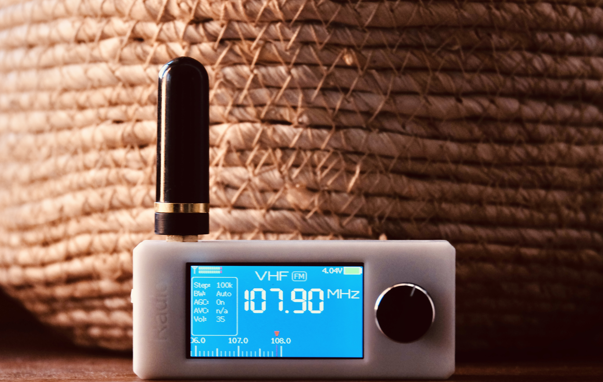

# Hardware Facts

The firmware targets the **Sunnygold SI4732 Mini Radio, PCB 1.2 reference design**. The connected unit shipped with a zooc firmware variant. That firmware name does not establish its PCB revision or display controller; those have not been independently confirmed from the unit's markings.

This document separates schematic facts, software configuration, and observations on the connected receiver. For architecture and receiver behavior, see [Design](design.md).

- [Sources and reference assets](#sources-and-reference-assets)
- [Schematic facts](#schematic-facts)
- [GPIO map](#gpio-map)
- [Display configuration and observations](#display-configuration-and-observations)
- [Battery indication](#battery-indication)
- [Connected-unit verification](#connected-unit-verification)

## Sources and reference assets

| Source | Purpose |
| --- | --- |
| [Sunnygold original project](https://oshwhub.com/sunnygold/esp32s3-si4732-shou-yin-ji) | Original board design; attachments were obtained from the mirror below |
| [Hardware attachment mirror](https://github.com/esp32-si4732/esp32-si4732-oshwhub/tree/6105532703f85a0275950600ff4f040d1f831b24/FILES/2025-01-22) | Schematic, PCB, fabrication and enclosure references |
| [Chinese firmware reference](https://github.com/zhang-chong/4732mini/tree/5334e7bc5e44a7b66bbbbd5183164147ec5f8641) | GPIO, LCD, battery, and receiver-configuration comparison; exact equivalence to the factory firmware is unconfirmed |
| [ATS Mini community firmware](https://github.com/esp32-si4732/ats-mini/tree/ab4f5dc8120767cbb134b70096929f74c49df3e7) | Display variants, hardware observations, and receiver references |
| [Community hardware notes](https://esp32-si4732.github.io/ats-mini/hardware.html) | Board and display variations |
| [SI4732-A10 data short](https://www.skyworksinc.com/-/media/Skyworks/SL/documents/public/data-shorts/Si4732-A10-short.pdf) | Receiver capabilities and broadcast frequency ranges |

Local references:

| File | Content |
| --- | --- |
| [Schematic](SCH_SI4732_1.2.pdf) | Original PCB 1.2 schematic, dated 2024-08-19 |
| [PCB layout](PCB_SI4732_1.2.pdf) | Original board layout |
| [Front view](images/radio-front.jpg) | Community reference receiver exterior |
| [Chinese UI](images/radio-chinese-ui.png) | Community reference firmware screen |
| [PCB/buttons](images/pcb-buttons.jpg) | Community photograph of the board and unpopulated button positions |

The PDFs are unchanged copies. Reference photographs were renamed, not modified; they show reference units, not this user's receiver. Their upstream paths are `docs/source/_static/esp32-si4732-ui-theme.jpg`, `esp32-si4732-chinese-ui.png`, and `boot-reset-buttons-missing.jpg` at the community commit above. Current firmware screenshots named `screen-*.png` are separate framebuffer captures made with [the capture tool](../tools/capture_screen.py). Imported asset terms and credits are in [Third-party notices](development.md#third-party-notices).

## Schematic facts

- **Processor:** U4 is ESP32-S3-WROOM-1-N16R8, specifying 16 MB flash and 8 MB PSRAM. Firmware targets 16 MB flash and does not require PSRAM. The PlatformIO `esp32-s3-devkitc-1` ID supplies the S3 build configuration; it is not a claim that this is an Espressif development board.
- **Receiver:** U2 is SI4732-A10-GSR. R13/R14 are 10 kΩ I2C pull-ups to `VCC_RADIO`. SENB connects to that rail. The driver probes both `0x11` and `0x63`; address polarity must not be inferred from another SI47xx part.
- **Power:** The controller and radio have separate ME6217C33M5G 3.3 V regulators. GPIO15 drives the radio regulator's CE, high to enable. Switching this rail off does not shut down the whole receiver.
- **Radio reset:** GPIO16 is active low.
- **LCD bus:** DB0–DB7, WR, RD, DC, CS, and RST form an 8080 8-bit parallel interface. Q1/S8050 drives the backlight, high to enable. The schematic does not identify the display-controller part.
- **Controls:** U12 is an EC1106S rotary encoder. A/B and its push switch pull their inputs to ground. The EN reset button is not an application input; GPIO0 is the boot/download input.
- **Audio:** U9 is NS4160. The schematic describes C21/R22/JP3 changes for an AD4150B replacement. The receiver's analog L/R outputs feed the audio path. GPIO3 controls mute and GPIO10 controls amplifier enable, both active high.
- **Battery ADC:** R8 and R10 are both 100 kΩ, so GPIO4 reads half of `VCC_BAT`. The divider does not connect directly to cell BAT+.

## GPIO map

The authoritative software mapping is [`src/boards/ats_mini/pins.h`](../src/boards/ats_mini/pins.h). These are GPIO numbers, not module-pad numbers.

| Resource | GPIO | Behavior |
| --- | --- | --- |
| Battery ADC | 4 | Divider ratio 2 |
| LCD reset / CS / DC | 5 / 6 / 7 | Parallel display control |
| LCD WR / RD | 8 / 9 | Parallel display strobes |
| LCD DB0…DB7 | 39, 40, 41, 42, 45, 46, 47, 48 | 8-bit data bus |
| Backlight | 38 | High/PWM enables light |
| Radio power / reset | 15 / 16 | Power high; reset low |
| I2C SDA / SCL | 18 / 17 | 100 kHz |
| Audio mute / amplifier | 3 / 10 | High enables the respective control |
| Encoder A / B / push | 2 / 1 / 21 | Pull-up, active low |
| BOOT | 0 | Active low; affects download mode at reset |
| USB D− / D+ | 19 / 20 | Native USB and CDC serial |

GPIO35–37 are reserved by the N16R8 module's OPI PSRAM wiring and should not be assigned as ordinary resources.

The HAL holds reset low while the radio is off and leaves I2C inputs floating, because the pull-ups are on the switched radio rail. It enables the regulator, starts I2C, and resets the receiver before probing it.

## Display configuration and observations

The current HAL uses an ST7789 configuration with 240-pixel controller width, a 35-pixel visible-area offset, and a 170 × 320 panel area. Rotation 3 gives the application's 320 × 170 landscape display. Community receivers also include GC9307 variants; the schematic alone cannot settle the fitted controller.

On 2026-10-13, the user confirmed correct display orientation, RGB colors, encoder rotation, and encoder push behavior. Rotation 1 was upside down on this unit. These observations support the current configuration but do not identify every production variant.

## Battery indication

R8/R10 divide `VCC_BAT` by two before GPIO4. This node is not directly BAT+: on battery power it approximates cell voltage, while USB can feed it through the SS34 path. Consequently, its voltage cannot establish cell charge while connected to USB. There is no confirmed dedicated fuel-gauge measurement in this configuration.

Firmware ADC averaging, plausibility thresholds, external-power inference, and percentage calculation are described in [Design](design.md#battery-interpretation). Calibration is in [Development](development.md#battery-calibration), and the status-bar symbols are in the [user manual](user-manual.md#battery-estimate). Cell capacity, chemistry, aging, and per-unit calibration have not been established here.

## Connected-unit verification

- esptool identifies ESP32-S3 revision v0.2, 16 MB flash, and 8 MB PSRAM.
- The radio responds at I2C `0x63`.
- GET_REV reports FM component 7.0 and AM component 6.0. Part/main-firmware fields return zero and do not further identify the fitted chip.
- Loaded SSB patch ID is `0xA902`.
- Tune-command readback has been exercised on LW/MW/SW/FM, including SSB BFO control.
- FM 95.9 MHz has yielded PS `LOVE959` and ordinary RT on the connected unit. After flashing the eRT implementation, PS and RDS synchronization were observed again, but no eRT announcement was received during that observation. UTF-8 eRT is validated with constructed groups and a simulated FIFO, not yet with an on-air eRT broadcast.
- Exact PCB revision, fitted LCD-controller markings, RF sensitivity, SSB listening quality, absolute frequency accuracy, and battery calibration remain unverified.

The [development guide](development.md) covers battery calibration, diagnostics, and verification procedures. Host tests and tune readback do not establish RF sensitivity, audio quality, or oscillator accuracy.
