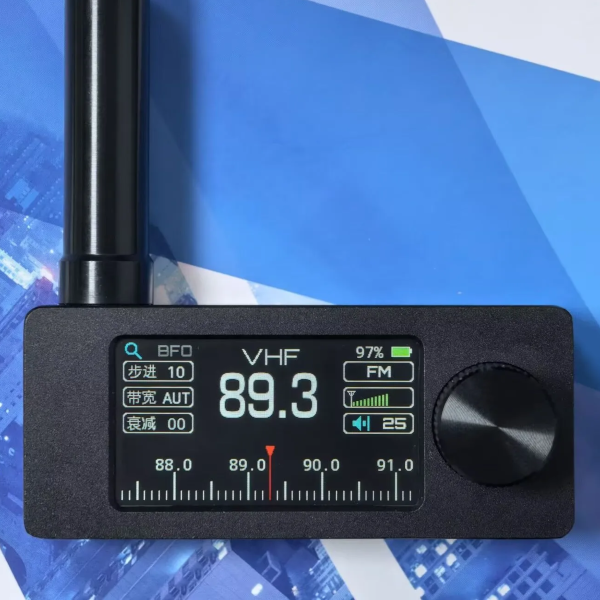
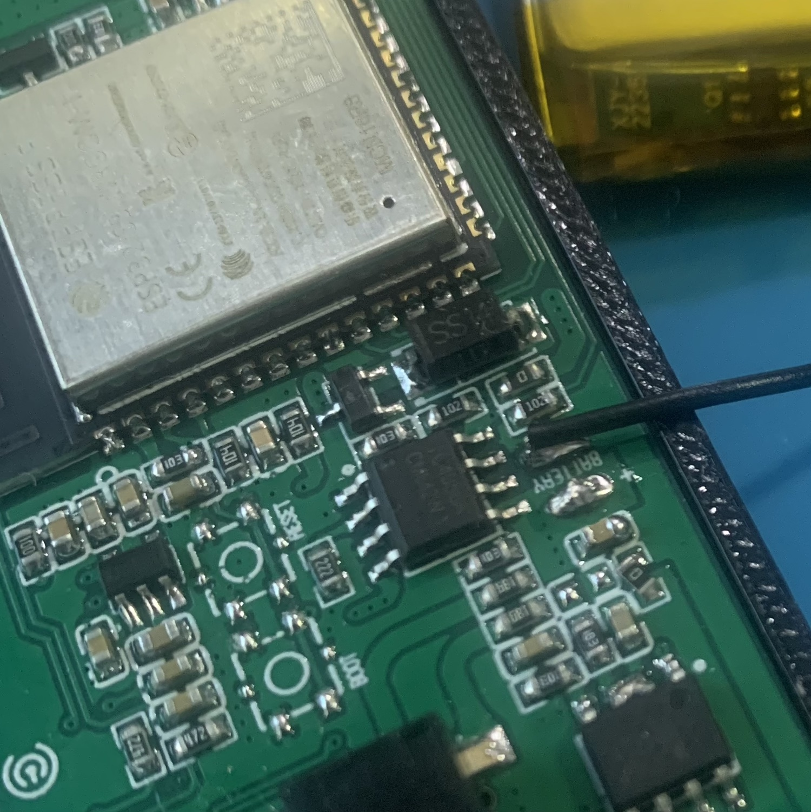

# SI4732 Mini Radio 硬件记录

资料核对日期：2026-10-13。当前实现以 Sunnygold **PCB 1.2** 为基准；用户报告自带 zooc 固件。尚未通过实物丝印确认用户机器的 PCB 和 LCD 型号。固件名称不能单独证明硬件版本。

实机更新：2026-10-13，USB 连接的设备通过 esptool 确认为 ESP32-S3 revision v0.2、16 MB Flash、8 MB PSRAM。电量示例已刷入；用户确认屏幕有显示，但 rotation=1 时上下翻转，因此横向方向改为 rotation=3。PCB 版本、LCD 控制器与电压校准仍待确认。

## 来源与本地资料

- [Sunnygold 原始项目](https://oshwhub.com/sunnygold/esp32s3-si4732-shou-yin-ji)：立创开源页面，本次网页读取失败，附件从下面的公开镜像取得。
- [原始附件镜像](https://github.com/esp32-si4732/esp32-si4732-oshwhub/tree/6105532703f85a0275950600ff4f040d1f831b24/FILES/2025-01-22)：电路图、PCB、Gerber、外壳模型、早期固件。
- [中文固件源码](https://github.com/zhang-chong/4732mini/tree/5334e7bc5e44a7b66bbbbd5183164147ec5f8641)：社区镜像 README 指向的后续中文版本；可对照 zooc 引脚和电池校准实现，**尚未确认与用户出厂版本完全一致**。
- [ATS Mini 社区固件](https://github.com/esp32-si4732/ats-mini/tree/ab4f5dc8120767cbb134b70096929f74c49df3e7)：另一个固件分支，不等同于 zooc；其 `ats-mini/Display.h` 可核对 LCD 总线、尺寸和屏幕变体。
- [社区硬件说明](https://esp32-si4732.github.io/ats-mini/hardware.html)、[备份恢复说明](https://esp32-si4732.github.io/ats-mini/recovery.html)。
- [PU2CLR SI4735 驱动](https://github.com/pu2clr/SI4735)：SI4732/35 命令、AM/FM/SSB 参考；SSB 需要加载补丁；当前实现见 [收音功能](radio.md)。

本地文件：

| 文件 | 内容与来源 |
| --- | --- |
| [SCH_SI4732_1.2.pdf](SCH_SI4732_1.2.pdf) | 原始附件电路图，图纸日期 2024-08-19 |
| [PCB_SI4732_1.2.pdf](PCB_SI4732_1.2.pdf) | 原始附件 PCB 布局 |
| [radio-front.jpg](images/radio-front.jpg) | 社区仓库 `docs/source/_static/esp32-si4732-ui-theme.jpg`，机身外观参考 |
| [radio-chinese-ui.png](images/radio-chinese-ui.png) | 同目录 `esp32-si4732-chinese-ui.png`，中文固件外观参考 |
| [pcb-buttons.jpg](images/pcb-buttons.jpg) | 同目录 `boot-reset-buttons-missing.jpg`，PCB 与未焊接按键位置参考 |

图片为参考机型，非用户实物照片。PDF 原样复制，图片只重命名；来源 commit 见上方。原始镜像 README 标注 Sunnygold 硬件及软件为 CC BY-NC-SA 3.0，保留原作者 Sunnygold 和固件贡献者署名；图片沿用来源仓库的版权归属，不能推断所有照片具有相同授权。中文仓库声明仅供学习交流、禁止商用。新代码没有复制其应用代码。

## 原始电路图中的事实

- U4 标注 **ESP32-S3-WROOM-1-N16R8**：16 MB Flash、8 MB PSRAM 的模块型号。本示例按 16 MB 配置，不使用 PSRAM，以避免把其他批次的 PSRAM 模式作为启动前提。开发板 ID 用 `esp32-s3-devkitc-1` 提供通用 S3 构建支持，不代表实物是开发板。
- U2 是 **SI4732-A10-GSR**，I2C 总线由 R13/R14（10 kΩ）上拉至 `VCC_RADIO`。SENB 接该电源；SI4732 与部分 SI4735 型号的 SEN 极性不同，驱动实际探测 `0x11` / `0x63`，不凭引脚电平固定地址。GPIO16 控制低有效复位。
- 控制板和收音板分别由 ME6217C33M5G 提供 3.3 V；GPIO15 控制收音板 LDO 的 CE，高电平开启。关闭收音板不等于关闭整机。
- LCD 排线使用 DB0–DB7、WR、RD、DC、CS、RST，即 **8080 8 位并口**。它不是 T-Embed 的 SPI 接法。Q1 S8050 控制背光，高电平亮。
- 固件参考的 LCD 可视区域为 **170 × 320**；ST7789 显存宽 240，可视区域 X 偏移 35，横向显示 320 × 170。电路图没有标注 LCD 控制器型号；当前默认 ST7789，部分销售批次的 GC9307、色序、方向及 gamma 需实物验证。
- U12 是 EC1106S 旋转编码器，A/B 和按下开关 SW 接地有效。EN 复位键不是可供应用读取的 GPIO 按键；GPIO0 是启动下载按键。
- U9 标注 NS4160，图纸也注明 AD4150B 替换时的 C21/R22/JP3 改动。SI4732 的 L/R 模拟输出连接到功放和 3.5 mm 接口；GPIO10 开启功放，GPIO3 高电平通过 Q2/Q3 静音。声音不是 ESP32 PWM 蜂鸣器，当前 HAL 只控制静音与功放使能。
- TP4056 负责单节电池充电，AO3401、SS34 和 SW3 构成电源路径。充电状态引脚没有接到 MCU，不能准确读取“正在充电”状态。

## GPIO 对照

所有编号为 ESP32 GPIO，代码唯一来源为 `src/hal/board.h`。

| 资源 | GPIO | 方向/有效电平 |
| --- | --- | --- |
| 电源 ADC | 4 | ADC1，R8/R10 分压节点 |
| LCD RST / CS / DC | 5 / 6 / 7 | 输出，RST/CS 低有效 |
| LCD WR / RD | 8 / 9 | 并口写/读选通 |
| LCD D0–D7 | 39, 40, 41, 42, 45, 46, 47, 48 | 并口数据，按 D0 至 D7 顺序 |
| 背光 | 38 | 高有效，LEDC 通道 0，5 kHz、8 bit |
| 收音电源 / 复位 | 15 / 16 | 电源高有效 / 复位低有效 |
| I2C SDA / SCL | 18 / 17 | 本示例 100 kHz |
| 静音 / 功放使能 | 3 / 10 | 高有效 |
| 编码器 A / B / SW | 2 / 1 / 21 | 输入，上拉，低有效 |
| BOOT | 0 | 低有效，启动时影响下载模式 |
| USB D− / D+ | 19 / 20 | 原生 USB，串口日志走 USB CDC |

GPIO35–37 不应作为普通资源使用，N16R8 的 OPI PSRAM 会占用它们。

## 电量测量的含义

原图 R8 = R10 = **100 kΩ**，因此 GPIO4 测量值乘 **2**。节点上端为 **VCC_BAT**，不是直接连接电池 BAT+：使用电池供电时可近似看作电池电压；接入 USB 后可能反映经过 SS34 的 USB 供电，不能当作真实电芯电量。

实现平均 32 次 `analogReadMilliVolts()`，使用 ESP32 ADC 毫伏校准 API，11 dB 衰减，计算 `V = ADC_mV × 2 × calibration / 1000`。`batteryCalibration` 默认 1.0，建议断开 USB、用万用表测同一供电节点，设置为实测电压 / 示例读数。中文固件的 1.71 和社区的 1.702 是 **原始 ADC 码值到电压**系数，不能再乘到校准毫伏读数上。

屏幕百分比为 3.2–4.2 V 的线性粗略估计，限制在 0–100%；不是电量计，也不是硬件欠压保护。负载、温度、电池化学特性及老化都会影响结果。超过 4.35 V 只标注 `USB?`，该阈值不能可靠识别所有 USB 状态；插 USB 时即使低于阈值，也不能保证百分比有意义。2.5–5.5 V 外的读数标记异常。没有电池容量或用户电芯型号的可靠证据，未写入这些参数。

## 软件边界与实机验证

- `src/hal`：屏幕、背光、电池、编码器、按键、模拟音频使能与收音供电/I2C 资源。
- `src/drivers/si473x`：实现 FM/AM/LSB/USB 命令、CTS/STC 检查、SSB 补丁加载及信号质量读取；由 HAL 先供电和复位，不把板级 GPIO 放入芯片驱动。详见 [收音功能](radio.md)。
- `src/examples/battery_screen.cpp`：首个电量屏幕示例，整机启动后保持收音供电关闭、功放关闭、静音开启。LCD 初始化返回成功仅代表软件初始化完成，不能证明屏幕实物显示正常。

构建与运行步骤见项目 README。需要实机确认：屏幕可视区域、方向、RGB 色序，旋转和按下事件，断开 USB 后电压与万用表的差异。声音目前只验证安全初始化，不声称听感或收音功能已验证。

2026-10-13 实机确认补充：用户确认屏幕方向、RGB 色序以及编码器旋转/按下正常。当前默认程序已升级为收音界面；电量示例保留在 `src/examples`，通过 `BATTERY_DEMO` 构建宏选择。

收音实机核对：I2C 地址为 `0x63`；GET_REV 返回 FM 组件 7.0、AM 组件 6.0。part 与主固件版本字段均返回 0，不能用它们进一步判断实物型号；SSB 补丁加载后 patch ID 为 `0xA902`。原生模型测试与 USB 收音命令测试均通过；实际电台接收音频、SSB 听感与频率校准尚待用户确认。
